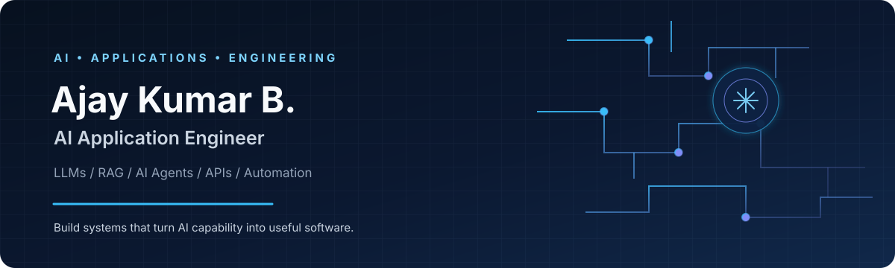
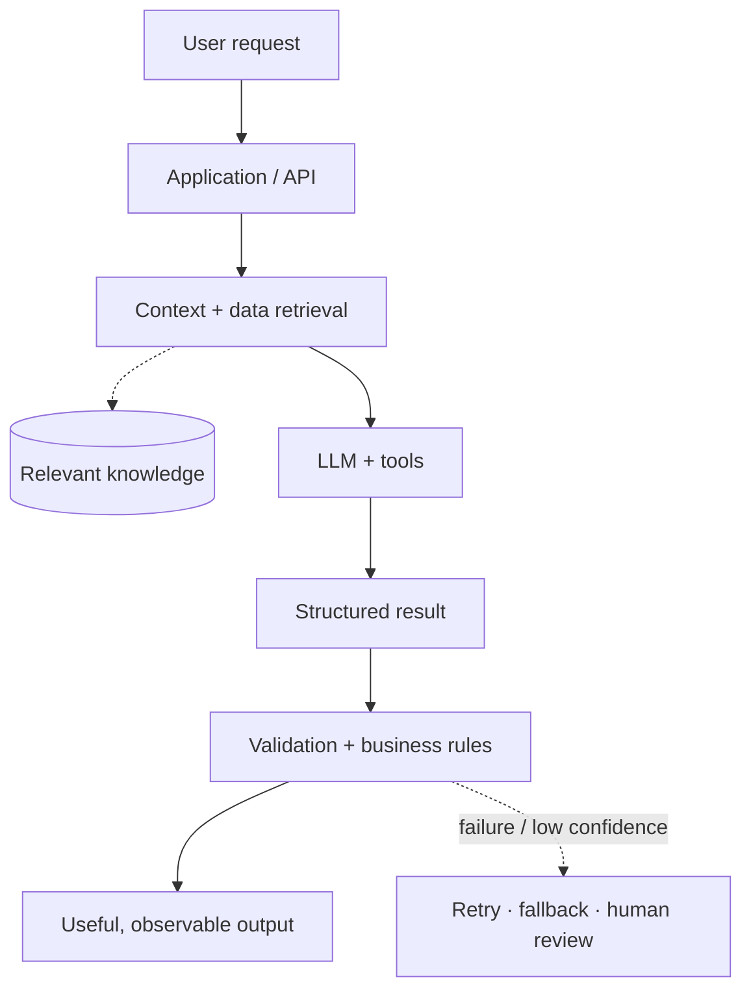

<div align="center">



### AI Application Engineer · Python · LLMs · RAG · AI Agents

**Building useful AI applications — not just model demos.**

[](https://github.com/Ajaykumar-dev-07)
[](https://linkedin.com/in/ajay-kumar-b-144420251)
[](mailto:jayakodiajay7@gmail.com)

</div>

---

## `01` / Engineering Profile

I'm an **AI Application Engineer** who designs and builds software that puts modern AI capabilities to practical use. I integrate language models into applications, connect them to data and tools, and write the backend logic that makes an AI feature useful and dependable.

I care about the **whole application**, not only the prompt: API design, data flow, structured outputs, validation, error handling, and maintainability.

```python
from dataclasses import dataclass


@dataclass
class AIApplicationEngineer:
    name: str = "Ajay Kumar B"
    role: str = "AI Application Engineer"
    primary_language: str = "Python"
    focus: tuple = (
        "LLM application development",
        "Retrieval-Augmented Generation (RAG)",
        "AI agent workflows",
        "Backend APIs and automation",
    )
    principle: str = "Use AI for reasoning; use software engineering for reliability."

    def approach(self, problem: str) -> list[str]:
        return [
            f"Understand: {problem}",
            "Design the data flow and interfaces",
            "Integrate models, retrieval and tools",
            "Validate outputs with schemas and business rules",
            "Improve using logs, evaluation and feedback",
        ]
```

---

## `02` / Areas of Focus

<table>
<tr>
<td width="50%" valign="top">

### 🤖 Generative AI Applications
- LLM API integration (OpenAI, Gemini, Claude)
- Prompt design and structured responses
- Retrieval-Augmented Generation (RAG)
- Embeddings and vector search
- Tool calling and agent workflows
- Model output validation

</td>
<td width="50%" valign="top">

### ⚙️ Application Engineering
- Python backend development
- REST API design (FastAPI, Flask)
- Database integration (PostgreSQL, MySQL)
- Workflow and browser automation
- API testing and quality checks
- Error handling and maintainable code

</td>
</tr>
</table>

---

## `03` / Technical Toolkit

**Languages & frameworks**


**LLMs & AI tooling**


**Data & persistence**


**Testing, automation & developer tools**


**AI ecosystem:** LLM APIs · RAG pipelines · Embeddings & vector search · Tool calling · Agent orchestration · Agentic development with Claude Code

> *This is a working toolkit, not a claim of equal depth in every technology. I keep expanding it through hands-on implementation.*

---

## `04` / How I Think About AI Systems



**Guiding principles**

- **Build systems, not just demos.** An AI feature needs a clear purpose and a usable interface.
- **Ground answers in context.** Retrieve relevant information when the task depends on private or domain-specific data.
- **Validate critical outputs.** Treat model responses as untrusted input: schema checks and business rules come first.
- **Keep responsibilities clear.** Models handle language and flexible reasoning; deterministic code handles rules that must be consistent.
- **Design for failure.** Plan for timeouts, missing data, retries, logging, and human review where appropriate.

---

## `05` / What I'm Exploring

- 🧱 Production-ready patterns for LLM applications
- 🔎 RAG evaluation, retrieval quality, and grounding
- 🛠️ Tool-using agents with controlled execution
- ⚡ Reliable AI APIs and asynchronous workflows
- 🔗 Python and .NET approaches to AI integration

---

<!--
## `06` / Featured Projects
Replace REPO_NAME with your repository names, then remove this comment wrapper.

<a href="https://github.com/Ajaykumar-dev-07/REPO_NAME">
  
</a>
<a href="https://github.com/Ajaykumar-dev-07/REPO_NAME_2">
  
</a>
-->

## `06` / GitHub Activity

<div align="center">


</div>

---

## `07` / Beyond the Code

I'm pursuing an **M.Tech in Artificial Intelligence & Data Science** while strengthening the engineering foundations behind AI applications: problem decomposition, backend design, testing, and clear technical communication.

I value practical learning, readable code, useful documentation, and projects that explain not just *what* was built, but *why* the design works.

---

## `08` / Connect

I'm open to conversations about AI application development, backend engineering, and collaboration.

- 💼 LinkedIn: [Ajay Kumar B](https://linkedin.com/in/ajay-kumar-b-144420251)
- 📧 Email: [jayakodiajay7@gmail.com](mailto:jayakodiajay7@gmail.com)
- 🐙 GitHub: [@Ajaykumar-dev-07](https://github.com/Ajaykumar-dev-07)

<div align="center">

*Understand the problem. Engineer the system. Make AI useful.*

</div>
